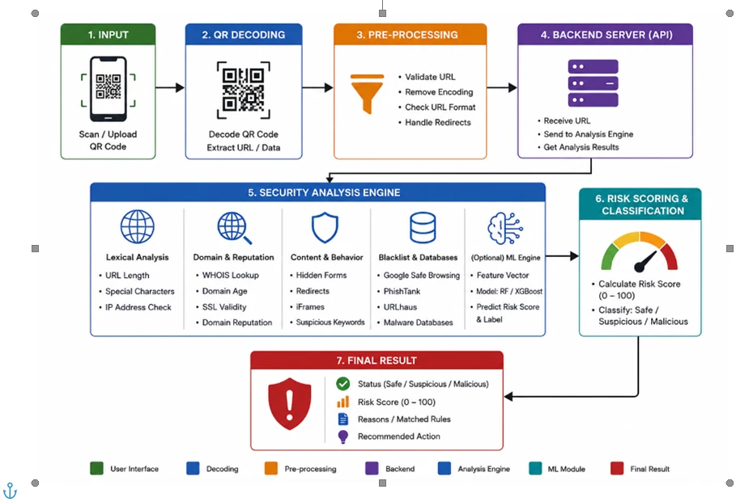

# Requirements traceability: original block diagram → implementation (27 October 2026)

**Source of truth:** the QRGUARD block diagram supplied by the project owner on 2026-10-26, stored
unchanged as [`docs/diagrams/qrguard-block-diagram.webp`](diagrams/qrguard-block-diagram.webp).

The diagram has seven stages: **1 Input → 2 QR Decoding → 3 Pre-processing → 4 Backend Server
(API) → 5 Security Analysis Engine → 6 Risk Scoring & Classification → 7 Final Result**. Stage 5
has five modules (Lexical, Domain & Reputation, Content & Behavior, Blacklist & Databases,
(Optional) ML Engine).

The owner's written instructions of the same day bind how two kinds of gap are treated:

- *Distinguish invalid input, unverified input, suspicious input, and confirmed malicious input.*
- *Do not invent a WHOIS integration, ML model, threat-intelligence database, or real-time
  content-analysis capability simply to match the diagram.*
- *Content and redirect analysis: only where safely implementable without introducing SSRF,
  malware retrieval, or unsafe browsing risks.*

## Status rules

| Status | Meaning |
|---|---|
| **PASS** | Exercised end to end (API integration tests and/or the full-stack browser E2E) **and** the result matches the diagram |
| **PARTIAL** | Part of the requirement is implemented and verified; the rest is missing or deliberately limited |
| **FAIL** | The diagram requires it and it is not implemented. Some are deliberate, by the owner's instruction above |
| **NOT VERIFIED** | Code and tests exist, but behaviour has not been observed where it matters (live provider, production) |

"Unit tests pass" alone never counts as PASS.

**Production caveat (applies to every row):** production does not yet run this code.
- The web app on Vercel runs `main` (`5f24bbf`).
- The **backend on Render still runs `ac71014` (2026-09-30)**, because auto-deploy is off. Render
  therefore lacks the evidence-based verdict (#27) and the redirect hardening (#29).
- Every row is **NOT VERIFIED in production** until Render is redeployed and checked.

Evidence key:
- **E2E** = `bash e2e/run.sh`: Chromium → web build served with the production `vercel.json`
  headers → Flask/Gunicorn → Firebase Auth/Firestore emulators. No mocks.
- **API** = `backend/tests/integration`.
- **Unit** = unit tests.

## Traceability table

| # | Diagram requirement → acceptance criterion | Implementation (files / functions) | Evidence | Status | Corrective action |
|---|---|---|---|---|---|
| 1.1 | **Input: scan QR code**. A user can scan a QR code with the camera, and its content is analysed. | Web: `web/src/components/QrCameraScanner.tsx`, `pages/QrImageCheck.tsx`. Mobile: `mobile/src/app/scan/camera.tsx` | E2E (web): "live camera QR scan (fake camera shows a UPI refund QR) → SUSPICIOUS" passed on 2026-10-27. Mobile: row 1.3 | **PASS** (web); mobile **PARTIAL** (1.3) | — |
| 1.2 | **Input: upload QR image**. A user can upload an image, the QR inside is decoded and analysed. | Web: `pages/QrImageCheck.tsx` → `POST /api/analyze/qr`. Mobile: `app/check/image.tsx` → `POST /api/analyze/screenshot` | API: `test_api_qr.py`, `test_api_screenshot.py`, `test_verdict_policy.py` (real PNG fixtures). No browser E2E uploads an image | **PARTIAL** | Add an E2E upload check (web `QR code` page with `postman/fixtures/qr-lookalike-link.png`) |
| 1.3 | Mobile app: input → analysis → result → history | `mobile/` (Expo web export of the same code) | E2E `tests/mobile.mjs` passed 5/5 on 2026-10-27: link check saved to history, history shows only the verdict, isolation, delete-my-data. The camera scan and image upload are not E2E-tested (they need a device); unit tests only (`mobile/src/test/screens.test.tsx`) | **PARTIAL** | Test camera and upload on a real Android device with the next preview APK |
| 2 | **QR decoding: extract URL / data**. Decoding a QR yields its exact payload, classified as URL, UPI, Wi-Fi, text … | Server: `app/analyzers/qr_decoder.decode_qr_codes` (OpenCV, inverted codes, ≤5 codes), `qr_payload.classify`. Clients: camera decoders | Unit: `test_qr_decoder.py`, `test_qr_payload.py`. API: `test_api_qr.py`. E2E: live camera scan (row 1.1) | **PASS** | — |
| 3.1 | **Validate URL / check URL format**. Malformed input is rejected with a reason, never "corrected"; dangerous schemes are flagged | `app/analyzers/url_normalizer.normalize_url` (`INVALID_URL`, `INCOMPLETE_URL`, `UNSUPPORTED_PROTOCOL`) | Unit: `test_url_normalizer.py`. API: `test_api_url.py`, `test_verdict_policy.py`. E2E: `javascript:alert(1)` → MALICIOUS and never openable | **PASS** | — |
| 3.2 | **Remove encoding**. Percent-encoded and IDN hosts are decoded before analysis; excessive encoding is flagged | `normalize_url` (`unquote` of the host, IDNA/punycode), `url_features` `URL_ENCODED_CHARS` | Unit: `test_url_normalizer.py`, `test_url_features.py` only | **PARTIAL** (no API or E2E evidence) | Add an API test: `https://%70aypal.com/` → host `paypal.com`, `URL_ENCODED_CHARS` |
| 3.3 | **Handle redirects** (safely). The final destination of a redirecting link is found without SSRF | `app/analyzers/redirect_resolver.resolve_redirects`: HEAD only, public IPs only, IP pinning, hard per-request deadline incl. TLS, DNS cap, per-worker concurrency cap (#29). Mode `REDIRECT_RESOLUTION=shorteners_only` (`render.yaml`) | Unit/API: `test_redirect_resolver.py` (incl. slow-header and TLS-stall attacks), `test_net_safety.py`, `test_verdict_policy.py`; CI green on `main` | **PARTIAL**: only known shorteners are followed; an ordinary site's own redirect (offer.com → offers.com) is not detected. `all` was rejected in the security review | Owner decision: keep `shorteners_only`, or approve a new review for following all links |
| 4 | **Backend API: receive URL, send to analysis engine, return results** | `app/routes/analyze.py` (`/url`, `/message`, `/screenshot`, `/qr`), validation, size limits, rate limits, optional auth | API: `test_api_*.py`, Postman/Newman. E2E: every analysis check | **PASS** (local and CI); production **NOT VERIFIED** (Render runs `ac71014`) | Redeploy Render from `main`, then check `/api/health` |
| 5a.1 | **Lexical: URL length** | `url_features`: `URL_LONG`, `URL_VERY_LONG` | Unit + API | **PASS** | — |
| 5a.2 | **Lexical: special characters** | `URL_SPECIAL_CHARS`, `URL_BACKSLASH`, `URL_MIXED_SCRIPT`, `URL_USERINFO_AT` | Unit + API | **PASS** | — |
| 5a.3 | **Lexical: IP address check** | `URL_IP_HOST`, `URL_OBFUSCATED_IP` (decimal/hex/octal), `URL_PRIVATE_NETWORK_HOST` | Unit + API (5 test files) | **PASS** | — |
| 5b.1 | **Domain & Reputation: WHOIS lookup** | — | — | **FAIL**: not implemented, by the owner's instruction (no free, reliable, keyless source) | Owner decision: accept, or pick a WHOIS/RDAP provider and budget |
| 5b.2 | **Domain age** | — (depends on WHOIS) | — | **FAIL**: as 5b.1 | as 5b.1 |
| 5b.3 | **SSL validity** | Lexical `URL_NO_HTTPS` only. A TLS certificate is verified only when the redirect checker contacts the host (shorteners), giving `TLS_ERROR` | `test_redirect_resolver.py` | **PARTIAL**: the checked site's certificate is not validated for ordinary links | A certificate check means contacting every checked site, the same exposure as `REDIRECT_RESOLUTION=all`. Needs an owner decision and the same review |
| 5b.4 | **Domain reputation** | `lookalike.detect_lookalikes` (typosquatting, brand in domain, homoglyphs), curated trusted list, TI providers (5d) | Unit `test_lookalike.py`, API `test_verdict_policy.py` | **PARTIAL**: no live reputation source verified (see 5d) | see 5d |
| 5c.1 | **Content & Behavior: hidden forms** | — (page bodies are never downloaded) | — | **FAIL**: by the owner's instruction (SSRF / malware retrieval) | Would need an isolated fetch-and-render sandbox. Owner decision |
| 5c.2 | **Redirects** | see 3.3; plus `REDIRECT_CROSS_DOMAIN`, `REDIRECT_HTTPS_DOWNGRADE`, `REDIRECT_TO_PRIVATE_ADDRESS` | see 3.3 | **PARTIAL** | see 3.3 |
| 5c.3 | **iFrames** | — | — | **FAIL**: as 5c.1 | as 5c.1 |
| 5c.4 | **Suspicious keywords** | In the URL (`URL_PHISHING_KEYWORD`) and in messages/OCR text (`scam_rules.yaml`); not in page content | Unit + API (`test_api_message.py`, `test_audit_messages.py`) | **PARTIAL**: URL and message keywords yes, page keywords no | as 5c.1 |
| 5d.1 | **Google Safe Browsing** | `threat_intelligence/providers/safe_browsing.py` (v4 lookup, timeouts, 429/401/403 handling, cache) | Unit: documented-format responses (`test_threat_intel_provider_responses.py`). No live key | **NOT VERIFIED** | Optional: add `GOOGLE_SAFE_BROWSING_API_KEY` on Render (non-commercial use) |
| 5d.2 | **PhishTank** | `providers/phishtank.py` (key or opt-in anonymous mode) | Unit: documented formats. No live call | **NOT VERIFIED** | Optional: `PHISHTANK_ANONYMOUS=true` on Render |
| 5d.3 | **URLhaus** | `providers/urlhaus.py` (`Auth-Key`, `query_status` mapping incl. `unknown_auth_key`) | Unit: documented formats. Live: impossible from the dev sandbox (abuse.ch blocked). Production key status unknown | **NOT VERIFIED** | Add `URLHAUS_AUTH_KEY` on Render, redeploy, check `/api/health` → `urlhaus.enabled: true` and a link shows "URLhaus: Not listed" |
| 5d.4 | **Malware databases** | URLhaus (malware URLs), VirusTotal (`providers/virustotal.py`, lookup only), local demo feed (labelled demo data, never "verified") | Unit + E2E (demo feed hit labelled as demo) | **PARTIAL**: only the demo feed is active | as 5d.3 |
| 5e | **(Optional) ML engine: feature vector, RF/XGBoost, predicted score and label** | — | — | **FAIL (optional)**: not implemented, by the owner's instruction; scoring is rule-based and explainable | None unless the owner wants a trained model (needs a labelled dataset) |
| 6.1 | **Calculate risk score (0–100)** | `app/scoring/engine.score_indicators` | Unit `test_scoring_engine.py`, API; E2E shows "90/100" | **PASS** | — |
| 6.2 | **Classify: Safe / Suspicious / Malicious** | Score band `risk_level` ∈ SAFE/SUSPICIOUS/MALICIOUS (diagram classes, unchanged). Headline `verdict.label` adds **UNVERIFIED**: no warning signs, but no evidence of safety | API `test_verdict_policy.py`; E2E | **PARTIAL (deliberate deviation)**: the diagram's three classes exist as `risk_level`, but the headline uses four labels, following the owner's 26 Oct requirement | Owner decision: keep UNVERIFIED (recommended: a missing TI result is not proof of safety), or show only the three diagram classes |
| 7.1 | **Final result: status** | Web `components/ResultCard.tsx`; mobile `components/ResultView.tsx` | E2E (web): verdict text asserted | **PASS** (web) | — |
| 7.2 | **Risk score (0–100)** | `ScoreGauge` (web and mobile) | E2E (web) | **PASS** (web) | — |
| 7.3 | **Reasons / matched rules** | `IndicatorList` (web and mobile) | E2E (web): indicator text asserted | **PASS** (web) | — |
| 7.4 | **Recommended action** | `result.recommendation` rendered in both apps | Unit `ResultCard.test.tsx`; text visible in the E2E result | **PASS** (web) | — |
| 7.5 | *(Owner requirement, not in the diagram)* Guarded "Open checked link": opens exactly the checked URL in a new tab, after confirmation | `web/src/components/OpenCheckedLink.tsx`, `utils/links.ts` | **Production: confirming did nothing** (reported). Fixed in PR #30. E2E with Chromium's popup blocker on: confirm, refused scripted popups, cancel, user@host / `javascript:`; 16/17 on the old code, 17/17 on the fix | **FAIL in production → fixed in #30** (not merged or deployed) | Merge #30, release `develop` → `main`, verify on the live site |

## Verification runs behind this table (2026-10-27, local sandbox, not production)

| Command | Code under test | Result |
|---|---|---|
| `bash e2e/run.sh web` | `fix/web-open-checked-link` (PR #30) | **17/17** web checks, including the 4 open-link checks; backend-log privacy check passed |
| `bash e2e/run.sh web` | same suite, the old `OpenCheckedLink.tsx` | **16/17**: only "still opens when the browser refuses scripted popups" fails, which is the production symptom |
| `bash e2e/run.sh` | `develop` (`9548d18`) | web **13/13** (suite before #30), mobile **5/5**, privacy passed |
| `cd web && npm run lint && npm run typecheck && npm run coverage && npm run build` | PR #30 | clean / clean / **112 passed** / built |
| CI on `main` `5f24bbf` | backend-ci, web-ci, mobile-ci, e2e | all passed |

Not verified anywhere in this sandbox:
- production (Render still runs `ac71014`);
- live threat-intelligence providers (abuse.ch, Google and PhishTank are unreachable from the
  sandbox, and no keys are present);
- the Android camera and gallery on a real device.
